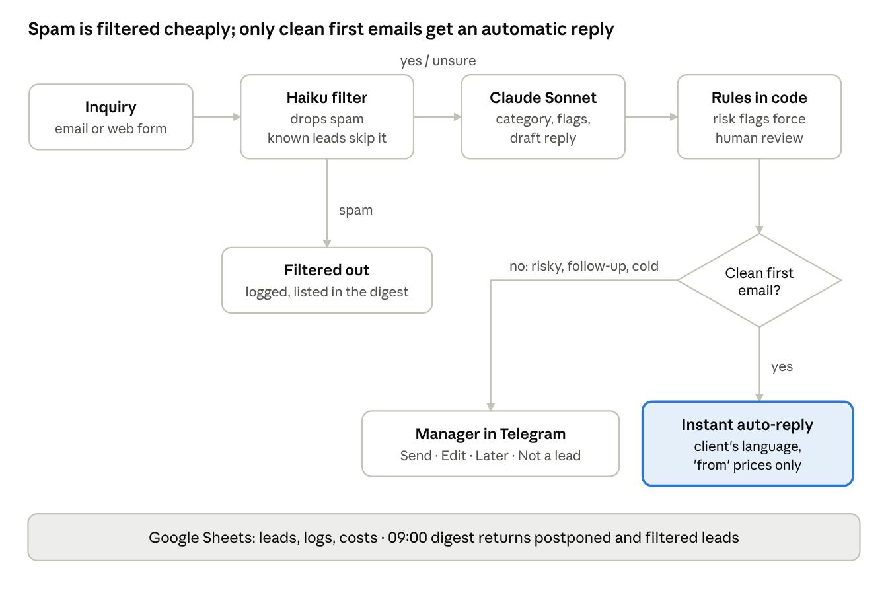

# Adria Blue Charter — AI Lead Agent (n8n + Claude)

An inbox assistant for a yacht charter company in Split, Croatia. It reads every incoming inquiry, decides whether it is a real client, classifies it, extracts the booking details, drafts a reply in the client's language and puts it in front of the sales manager in Telegram. A human approves everything that matters; clean first inquiries get an automatic reply.

> Demo build. The company is fictional, all test emails use `example.*` addresses. The same workflow runs in production on Gmail; this public copy writes "sent" emails to an Outbox sheet instead.



## What it does

1. **Intake**: Gmail (production) or a web form (demo). No-reply senders and duplicates are dropped by code.
2. **Lead filter (Claude Haiku)**: a ~$0.0001 call decides whether the email needs the expensive analysis. Spam, SEO offers and job applications stop here. When unsure, it lets the email through.
3. **Analysis (Claude Sonnet)**: category (`hot / warm / cold / needs_review / not_lead`), risk flags, dates, guests, boat type, skipper, license, budget, missing data, a one-line summary and a draft reply. Prices and rules come from a *Knowledge base* sheet, not from the model's memory.
4. **Follow-ups**: if the sender already exists in the CRM, the saved lead state is passed as `<history>` and merged, so the agent does not ask again what the client already answered.
5. **Human gate (Telegram)**: a card with the summary, flags and draft, and four buttons: ✅ Send, ✏️ Edit, ⏸ Later, ❌ Not a lead. *Edit* = reply to the card in plain words ("add that the skipper is €200/day") and Claude rewrites the draft.
6. **Auto-reply**: a first email is answered automatically when it is clean (`hot`/`warm`, no risk flags) or when its only flags are routine: dates outside the season ("the manager will contact you") or a budget below the lowest price (`cold`). Anything risky goes to the manager.
7. **CRM + logs**: every lead is upserted to Google Sheets; every model call is logged with tokens and cost.
8. **Daily digest** at 09:00 of everything postponed or still open; an error workflow alerts in Telegram.

## Design decisions

- **The model has no tools.** Claude only returns JSON. Sending, writing to the CRM and booking-like actions happen in code or after a human click. A prompt injection can at worst produce a bad draft that a human sees.
- **HTTP Request node instead of the n8n AI Agent node**: one deterministic call per email, full control of the payload, exact token accounting.
- **Hard rules in the prompt**: never confirm availability, exact price, discounts or bookings; only "from" prices from the knowledge base.
- **Email text is data**: wrapped in `<email>` tags, injection attempts are flagged `possible_injection` and routed to a human.
- **Two-model cascade**: Haiku filters, Sonnet analyses. Non-leads cost ~$0.00006 instead of ~$0.015.

## Test results

22 synthetic test emails (`tests/test_cases.csv`): hot/warm/cold leads in English, German, Croatian, Ukrainian and Italian, bareboat without a license, group too big, budget below price, off-season and season-boundary dates, existing booking change, complaint, two prompt-injection attempts, spam, a job application, follow-ups and "book it now" pressure. Expected results were defined when the test set was written.

The suite was run **3 times** (`tests/results_3_runs.csv`, 66 results):

| Metric | Result |
|---|---|
| Category matches expected | **66/66** (22/22 in every run) |
| Risk flags match expected | **66/66** |
| Spam/non-leads stopped by the Haiku filter | 3/3 per run |
| Injection attempts sent to a human | 2/2 per run |
| Auto-replies | 9 per run: clean first inquiries, off-season dates, budget below the lowest price |
| Processing time per email | ≈ 11 s average, 25 s max (test runs, sequential) |
| Average cost per email | **≈ $0.014** (≈ $0.016 full analysis, ≈ $0.00006 for filtered spam) |
| Cost of a full 22-email run | ≈ $0.30 |

Prices used: Sonnet $2 / $10 and Haiku $0.10 / $0.50 per million input/output tokens (calculated from logged tokens).

**What a previous version got wrong, and the fix.** In the first test round (31.10) the model wrote a correct reply to "late October or early November" but did not set the `off_season` flag, so the email was auto-answered without the off-season rule. The season check now runs in code from the extracted dates, not in the model. Rule changes (budget below the lowest price → cold, off-season → auto-reply that the manager will follow up) live in the *Knowledge base* sheet, not in code.

## Repository

```
workflow/adria_lead_agent_demo.json   n8n workflow export (93 nodes, credentials removed)
prompts/system_prompts.md             the three prompts: filter, analysis, rewrite
tests/test_cases.csv                  22 test emails with expected category and flags
tests/results_3_runs.csv              results of 3 runs (category, flags, tokens, cost)
tests/knowledge_base.csv              the company rules the agent works from
docs/architecture.png                 architecture diagram
```

## Run it yourself

1. Import `workflow/adria_lead_agent_demo.json` into n8n (Cloud or self-hosted).
2. Create a Google Sheet with the tabs *Knowledge base, Leads, Logs, Outbox, Test cases, Eval, Eval history* (headers as in the CSV files) and replace `YOUR_GOOGLE_SHEET_ID` in the workflow.
3. Add credentials: Anthropic API, Google Sheets OAuth2, Telegram bot. Replace `YOUR_TELEGRAM_CHAT_ID` with your own Telegram user id.
4. Open the *Inquiry form* trigger URL and send an inquiry, or run the *Run test suite* trigger.

## Stack

n8n · Claude Sonnet + Claude Haiku (Anthropic API) · Telegram Bot API · Google Sheets
